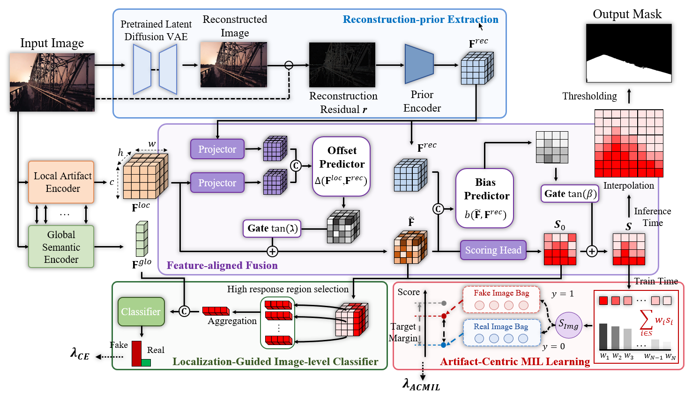

# Less Supervision, Better Generalization: Weakly Supervised Fake Region Localization in Diffusion-Edited Images [NeurIPS'26]

**LSBG** is the official repository for the NeurIPS 2026 paper, *Less Supervision, Better Generalization: Weakly Supervised Fake Region Localization in Diffusion-Edited Images*. The proposed model is **ReGFLoW**.

**Junhee Lee<sup>1</sup>**, **Donghyeon Jeon<sup>1</sup>**, **Taeoh Kim<sup>2</sup>**, **Beomyoung Kim<sup>2</sup>**, **MyeongAh Cho<sup>1,†</sup>**

*†Corresponding Author*

<sup>1</sup>Kyung Hee University · <sup>2</sup>NAVER

[](https://arxiv.org/abs/2609.36882)
[](https://visualsciencelab-khu.github.io/LSBG_project/)

## Overview

**More detailed supervision is not always better supervision.** In diffusion-edited images, artifacts can extend beyond the intended edit region. Pixel-level masks may therefore label useful forensic evidence outside that region as authentic, introducing misleading supervision and limiting generalization to unseen generators and datasets.

**ReGFLoW** addresses this mismatch through **weakly supervised fake region localization using only image-level real/fake labels**. Diffusion reconstruction errors provide spatial guidance in both feature and score spaces, while artifact-centric multiple instance learning captures local evidence without relying on semantic or object boundaries.



*Figure: ReGFLoW combines reconstruction-guided learning with artifact-centric multiple instance learning to localize diffusion-edited regions from image-level supervision.*

## Environment

Run the commands below from the LSBG repository root. The example uses Python 3.11 and the CUDA 12.1 build of PyTorch. For a different CUDA setup, select an appropriate build from the [PyTorch installation guide](https://pytorch.org/get-started/previous-versions/).

```bash
conda create -n lsbg python=3.11 -y
conda activate lsbg
python -m pip install torch==2.5.1 torchvision==0.20.1 --index-url https://download.pytorch.org/whl/cu121
python -m pip install -r requirements.txt
```

## Data Preparation

Download the OpenSDI training and test splits, or configure an existing Hugging Face dataset cache. Training requires image-level real/fake labels; evaluation also uses segmentation masks.

**[Data preparation guide](data_preparation/README.md)**

## Data Preprocessing

Prepare a VAE reconstruction-error map for each training and evaluation image. Existing maps can be reused if they follow the expected format and paths.

**[Data preprocessing guide](data_preprocessing/README.md)**

## Pretrained Models

ReGFLoW uses pretrained models for feature extraction. Download the official checkpoints following the instructions under `weights/`.

**[Pretrained model setup and backbone roles](weights/README.md)**

## Training

The reported ReGFLoW experiments use **one GPU**, and the implementation also supports **multi-GPU training with DDP**.

In [`configs/train.json`](configs/train.json), set `paths.output_dir` to the desired output directory, `runtime.num_processes` to the number of GPUs (`1` by default), and the `wandb` settings for your run. Set `training.resume` to an existing checkpoint only when resuming training. Data, reconstruction map, and pretrained model paths are configured in their respective guides above.

```bash
bash train.sh --config configs/train.json --check  # Optional input check
wandb login  # Required once for online W&B logging
bash train.sh --config configs/train.json
```

`--check` checks the required files and sample formats without training. 

Training checkpoints are saved under `paths.output_dir` (default: `./outputs/regflow/`). To resume training, set `training.resume` to the run's `last.pth`.

Each epoch also logs pixel-level validation for **P** and **P+F** separately in W&B (`val_pixel_P` and `val_pixel_PF`), alongside image-level validation (`val_image`).

## Evaluation

Before evaluation, set `paths.checkpoint` in [`configs/test.json`](configs/test.json) to the checkpoint you want to evaluate (for example, `./outputs/regflow/best.pth`). No checkpoint is selected by default; evaluation will not start until you provide a valid path. You can also change `paths.output_dir` (default: `./outputs/test`) and `runtime.num_processes` to select the GPU count.

```bash
bash test.sh --config configs/test.json
```

Evaluation reports pixel-level performance for **P** and **P+F**, together with image-level detection, across the configured test domains. Results are saved to `<paths.output_dir>/test_summary.json`.

## Acknowledgements

We thank the authors of [OpenSDI](https://github.com/iamwangyabin/OpenSDI), [MAE](https://github.com/facebookresearch/mae), [CLIP](https://github.com/openai/CLIP), [IML-ViT](https://github.com/SunnyHaze/IML-ViT), [IMDLBenCo](https://github.com/scu-zjz/IMDLBenCo), [AEROBLADE](https://github.com/jonasricker/aeroblade), and [Latent Diffusion](https://github.com/CompVis/latent-diffusion) for their work. [Third-party sources and licenses](THIRD_PARTY_NOTICES.md)
